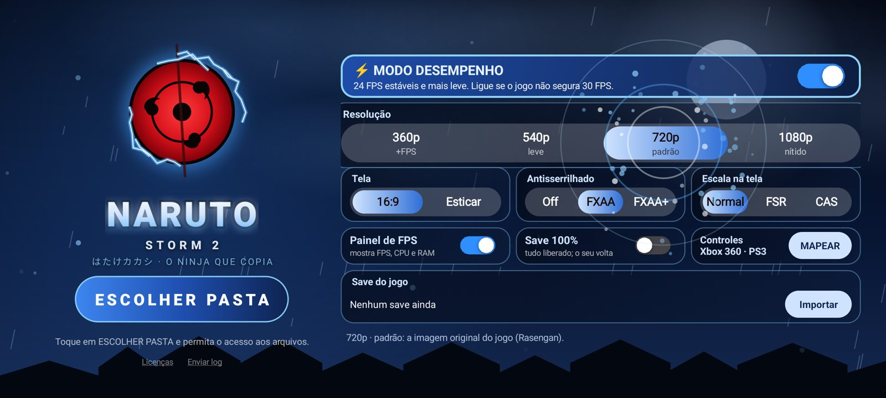
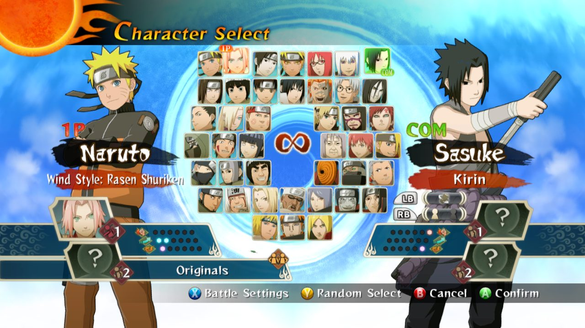

# 🌀 Naruto Shippuden: Ultimate Ninja Storm 2 — Port Nativo

**O jogo de Xbox 360 rodando nativamente no Android (ARM64) e no PC (Windows x64), sem emulador de CPU.**

[**⬇️ Baixar (Android e PC)**](../../releases/latest) · [Requisitos](#-requisitos) · [Instalação](#-instalação) · [Configurações](#%EF%B8%8F-configurações) · [Perguntas](#-perguntas-frequentes)

---

## 📖 Sobre

Este port **não é um emulador de Xbox 360**. O executável do jogo (`default.xex`) é **recompilado estaticamente** de PowerPC para ARM64 (celular) e x86-64 (PC): o resultado é código nativo, que roda direto no processador. A parte gráfica usa um backend Vulkan adaptado e otimizado para GPUs de celular, com um **render nativo** que faz as cópias e limpezas da memória de vídeo do Xbox 360 direto na GPU.

> [!IMPORTANT]
> **O APK e o pacote de PC não contêm nenhum arquivo do jogo.** Você precisa da sua **própria cópia** de *Naruto Shippuden: Ultimate Ninja Storm 2* para Xbox 360, na versão indicada em [Versão do jogo](#-versão-do-jogo-obrigatória).

### ✨ Destaques

- **⚡ Modo desempenho:** 24 FPS estáveis e com ritmo uniforme, mais leve, para celulares que não seguram 30. Fica em destaque no topo do menu, e a lógica do jogo acompanha o relógio, sem câmera lenta.
- **Menu em uma tela só**, sem rolagem, com um **efeito ninja para cada opção** (Chidori, folhas, shurikens, Rasengan, Sharingan, água, vento...), no tema do **Kakashi** ⚡.
- **Resoluções no celular:** 360p, 540p, 720p e 1080p (nítido). No PC também há 2K e 4K.
- **Antisserrilhado FXAA e FXAA+** e **escala FSR 1.0 / CAS** da AMD, que podem ser ligados e desligados.
- **Controles físicos configuráveis:** tela para mapear cada botão, com os nomes do **Xbox 360 e do PS3** lado a lado, e atalhos prontos (padrão, confirmar com ○, gatilhos ↔ ombros).
- **Save 100%:** um interruptor liga um save com tudo liberado e guarda o seu; desligar devolve o seu save. Também dá para **importar** um save (pacote do Xbox 360, arquivo solto ou `.zip`).
- **Controles na tela** com editor (mover, redimensionar, esconder e ajustar a transparência).
- **Drivers de GPU customizados (Turnip)** em celulares **Snapdragon**, importados direto pelo menu.
- **Painel de desempenho:** FPS, resolução e uso de CPU, GPU e RAM. Pode ser arrastado pela tela ou recolhido.
- **Modo 16:9 ou esticado** para a tela inteira.
- **Versão de PC** com janela ou tela cheia, teclado e controles de Xbox ou PlayStation.

## 📸 Capturas

| Menu inicial | Seleção de personagens |
|:---:|:---:|
|  |  |

## 📱 Requisitos

### Android

| | Mínimo | Recomendado |
|---|---|---|
| **Android** | 11 (API 30) | 13 ou mais novo |
| **Processador** | ARM64 (arm64-v8a) | Snapdragon 8 Gen 1 / Dimensity 8000 ou superior |
| **GPU** | Vulkan 1.1 | Mali-G710 / Adreno 730 ou superior |
| **RAM** | 4 GB | 8 GB ou mais |
| **Espaço** | espaço dos arquivos do jogo | — |

Testado no **Poco X7 Pro** (Dimensity 8400 Ultra, Mali-G720).

### 🖥️ PC

| | Mínimo | Recomendado |
|---|---|---|
| **Sistema** | Windows 10 64 bits | Windows 11 |
| **Processador** | x86-64 com AVX | 4 núcleos ou mais |
| **Placa de vídeo** | Vulkan 1.1 (drivers atualizados) | GTX 1060 / RX 580 ou superior |
| **RAM** | 4 GB | 8 GB ou mais |

## 💿 Versão do jogo (obrigatória)

O port é feito para **uma versão específica** do executável. O código é recompilado a partir deste arquivo, então o que vale é o `default.xex` ser **idêntico**: confira o hash abaixo.

> [!TIP]
> Use o disco **norte-americano (NTSC-U)** ou **japonês (NTSC-J)** cujo `default.xex` tenha o hash abaixo. Disco europeu (PAL) não serve.

| Campo | Valor |
|---|---|
| Jogo | Naruto Shippuden: Ultimate Ninja Storm 2 (Xbox 360) |
| Title ID | `4E4D0819` |
| Media ID | `6501C146` |
| Versão do executável | `0.0.0.4` |
| Trava de região do executável | NTSC-U (América do Norte) e NTSC-J (Japão); sem PAL |

| Arquivo | Tamanho | SHA-1 | MD5 |
|---|---|---|---|
| `default.xex` | 9.875.456 bytes | `7e7d863f6e35b4294f392f7f3331056dc8e99002` | `16597f7643c13cf235b8a016822c0318` |

<b>Como conferir o hash</b>

- **Windows (PowerShell):** `Get-FileHash default.xex -Algorithm SHA1`
- **Linux / macOS:** `sha1sum default.xex`
- **Android:** qualquer app de "hash checker" da Play Store.

## 🚀 Instalação

### Android

1. Baixe o **APK** na página de [**Releases**](../../releases/latest) e instale. Talvez seja preciso permitir *"instalar apps de fontes desconhecidas"*.
2. Copie a pasta do jogo para o celular, por exemplo `Armazenamento interno/Jogos/Naruto Storm 2`.
3. Abra o app e toque em **ESCOLHER PASTA**.
4. Permita o **acesso a todos os arquivos**: o jogo lê os dados direto da pasta, sem copiar nada.
5. Escolha a pasta que contém o `default.xex`.
6. Ajuste as configurações e toque em **JOGAR** ⚡

### 🖥️ PC (Windows)

1. Baixe o **`.zip` do Windows** na página de [**Releases**](../../releases/latest) e extraia numa pasta.
2. Abra **`NarutoStorm2.exe`**.
3. Clique em **ESCOLHER PASTA** e escolha a pasta do jogo, a que contém o `default.xex`.
4. Ajuste as configurações e clique em **JOGAR** (ou aperte Enter).

As configurações, os saves e o cache de shaders ficam na pasta onde você extraiu o port (`naruto.ini`, `data/`, `cache/`), não na pasta do jogo.

> [!TIP]
> Na primeira vez que cada cena aparece, o jogo compila shaders e pode engasgar um pouco. Nas próximas vezes eles já ficam salvos.

## ⚙️ Configurações

| Opção | O que faz | Impacto no desempenho |
|---|---|---|
| **Resolução 360p / 540p** | Renderiza com menos pixels | 🟢 Mais FPS: ideal para celulares mais fracos |
| **Resolução 720p** | Resolução original do Xbox 360 | ⚪ Padrão |
| **Resolução 1080p** | Imagem mais nítida na tela do celular | 🟠 Pesa um pouco a mais |
| **Resolução 2K / 4K** (PC) | Renderiza com 4x a 9x mais pixels | 🔴 Bem mais pesado |
| **Tela: 16:9 / Esticar** | Mantém a proporção original ou estica para a tela toda | ⚪ Nenhum |
| **Antisserrilhado: FXAA / FXAA+** | Suaviza as bordas serrilhadas | 🟠 Pesa um pouco a mais |
| **Escala na tela: FSR / CAS** | Amplia a imagem com mais nitidez (AMD FidelityFX) | 🟠 Pesa um pouco a mais |
| **⚡ Modo desempenho** (Android) | 24 FPS estáveis, até 540p, sem antisserrilhado e com escala simples | 🟢 Bem mais leve |
| **Painel de FPS** | Mostra FPS, resolução, CPU, GPU e RAM | ⚪ Quase nenhum |
| **Save 100%** | Liga um save com tudo liberado e guarda o seu | ⚪ Nenhum |
| **Controles › Mapear** | Escolhe qual botão do controle faz cada ação | ⚪ Nenhum |
| **Driver da GPU** (só Snapdragon) | Usa o driver do sistema ou um driver **Turnip** importado (`.zip` no formato AdrenoTools) | Depende do aparelho e do driver |

> [!NOTE]
> Se o FPS cair, use **Antisserrilhado: Off** e **Escala: Normal** e baixe a resolução.

## 🎮 Controles

- **Controles na tela:** encoste o dedo na área do analógico (por padrão, a **metade esquerda** da tela) para andar; os botões do jogo ficam no canto direito. Toque na engrenagem **⚙** no topo para mover, redimensionar ou esconder cada botão e ajustar a transparência. O botão do **olho** esconde os controles e o **⇔** alterna entre 16:9 e tela esticada.
- **Controle físico:** controles Bluetooth e USB compatíveis com Android são reconhecidos automaticamente. Para trocar botões, use **Controles › MAPEAR** no menu: toque numa ação e aperte o botão do controle que vai fazer isso.

### 🖥️ PC

Controles de Xbox e PlayStation funcionam direto. No teclado:

| Tecla | Botão | Tecla | Botão |
|---|---|---|---|
| **W A S D** | Analógico esquerdo | **Setas** | Analógico direito |
| **I J K L** | Direcional | **Enter** / **Tab** | START / BACK |
| **Espaço** | A | **E** | B |
| **Q** | X | **F** | Y |
| **1** / **3** | LB / RB | **Z** / **C** | LT / RT |
| **Ctrl esq. / dir.** | Apertar os analógicos | **F11** / **Alt+Enter** | Tela cheia |

## ❓ Perguntas frequentes

<b>O jogo fecha ao abrir / tela preta</b>

- Confira se o `default.xex` bate com o hash acima.
- Confira se a permissão de **acesso a todos os arquivos** foi dada.
- Confira se a pasta escolhida é a que contém o `default.xex`, e não uma pasta acima dela.
- Se você trocou o **Driver da GPU**, volte para **Sistema**.

<b>Dá para jogar a 60 FPS?</b>

Não. O jogo original conta o tempo em quadros, travado em 30 por segundo: a 60 ele simplesmente roda duas vezes mais rápido. 30 FPS estáveis é o mesmo do Xbox 360.

<b>Funciona com outra versão ou região do disco?</b>

Só se o `default.xex` for **idêntico** (mesmo SHA-1 da tabela). Com hash diferente, não funciona.

<b>O código-fonte está disponível?</b>

Não. Este é um projeto de código fechado. Os componentes de código aberto usados estão listados abaixo, com as respectivas licenças.

## 🙏 Créditos

Este projeto só foi possível graças a estes projetos de código aberto:

- [**XenonRecomp**](https://github.com/hedge-dev/XenonRecomp): recompilador estático de PowerPC (Xbox 360)
- [**Xenia Canary**](https://github.com/xenia-canary/xenia-canary): referência do hardware do Xbox 360 e base do backend Vulkan
- [**SDL 3**](https://github.com/libsdl-org/SDL): janela, entrada e áudio
- [**FFmpeg**](https://ffmpeg.org): decodificação de áudio XMA
- [**AMD FidelityFX FSR / CAS**](https://github.com/GPUOpen-Effects): escala e nitidez
- [**libadrenotools**](https://github.com/bylaws/libadrenotools): drivers de GPU customizados no Android

As licenças completas estão em [THIRD_PARTY_NOTICES.md](THIRD_PARTY_NOTICES.md).

## ⚖️ Aviso legal

Este é um projeto de fãs, **sem fins lucrativos**, sem nenhuma ligação com a Bandai Namco, a CyberConnect2, a Ubisoft, a VIZ Media, Masashi Kishimoto ou a Microsoft. *Naruto* e *Naruto Shippuden: Ultimate Ninja Storm 2* são marcas e obras de seus respectivos donos.

Os pacotes **não incluem** arquivos, vídeos, sons ou texturas do jogo: é preciso ter a sua própria cópia original. Não peça nem compartilhe arquivos do jogo nas issues.

---

Feito com 🧡

